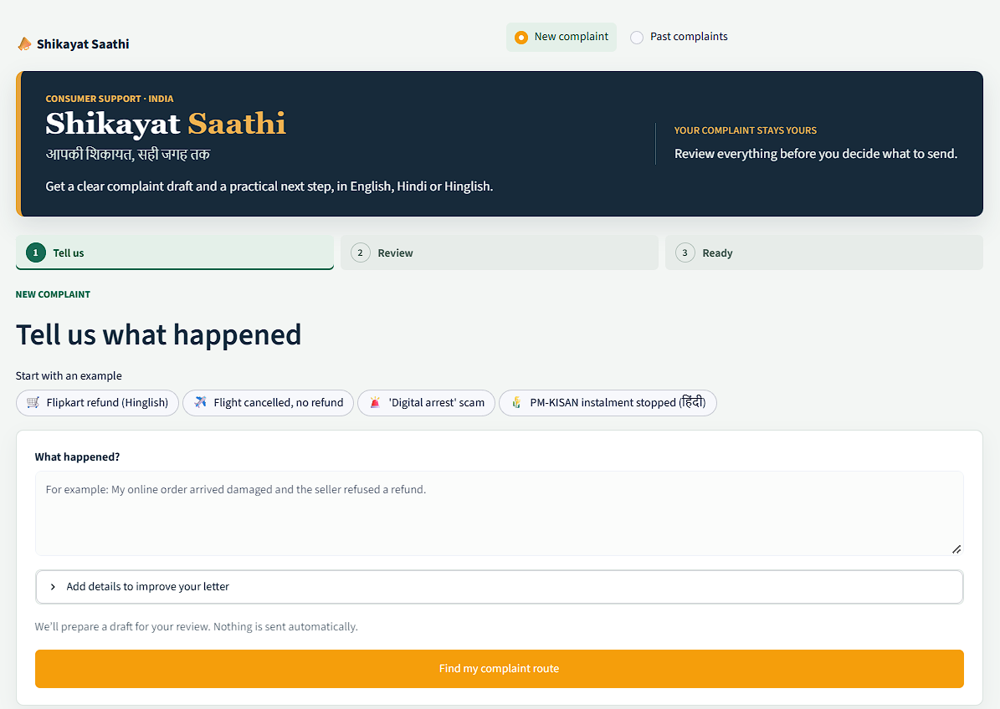
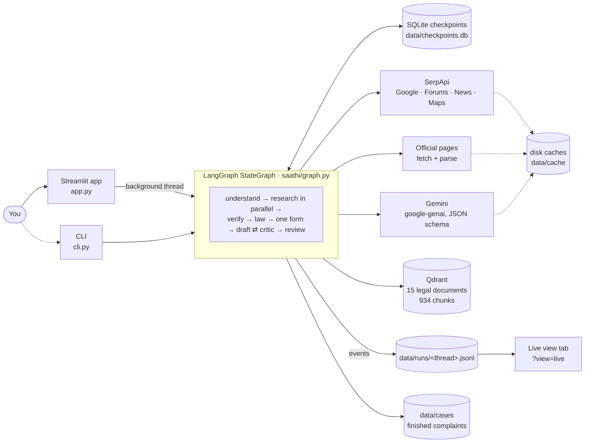
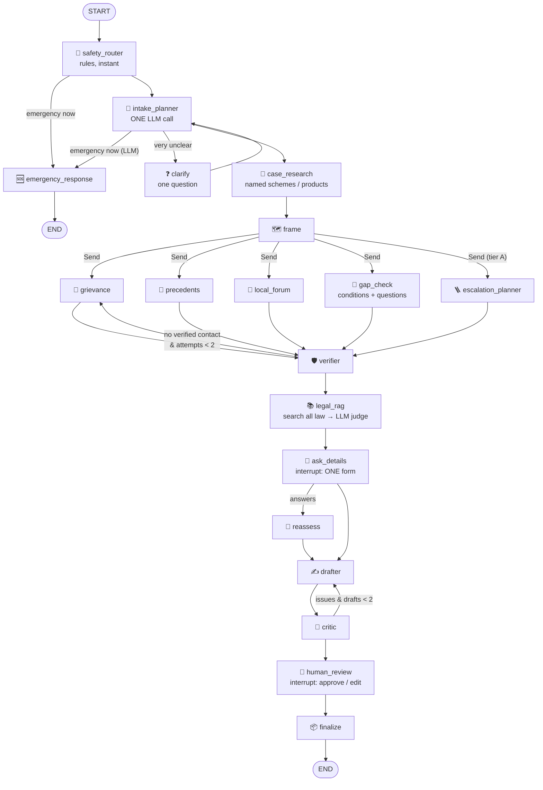

# Shikayat Saathi (शिकायत साथी)



**One front door for every grievance in India — with depth in consumer, banking, government-scheme, police and
court matters.**

People lose money and time not because they lack rights, but because they can't find the path to use them. Shikayat
Saathi takes a complaint written in English, Hindi or Hinglish ("Flipkart ne damaged phone ka refund reject kar
diya") and returns:

- a **verified** grievance contact for the organisation, with the page it was found on;
- the **escalation ladder**, every step traceable to an official source, with **deadlines computed in code**;
- the **legal clauses** that back the complaint — searched across the whole indexed law, then checked by the AI
  for whether each one governs *this* case (never invented; none rather than a wrong one);
- a ready-to-send letter in **one language** (English or Hindi), checked before you see it.

> **🔎 Built on SerpApi.** Four SerpApi engines find what no dataset or model memory has today: **Google** for
> official domains, grievance-officer pages, escalation routes and scheme rules; **Google Forums** and **Google
> News** for how similar complaints were resolved; **Google Maps** for the nearest consumer commission, cyber-crime
> police station or legal-aid office. Every search is cached and capped at **12 live searches per complaint**
> (typically 8–12), and nothing from a search is trusted until the page itself is fetched and checked.
> [How and why →](#serpapi-how-and-why-it-is-used)

**ChatGPT is smart; Shikayat Saathi is accountable.** The LLM understands the complaint and proposes; code checks
every contact, route step, citation, amount, date and deadline before it reaches a letter.

It is a **LangGraph** multi-agent system: workers run in parallel through `Send`, three loops correct their own
output, the user answers one form and reviews the letter through `interrupt()`, and every complaint is checkpointed
in SQLite. Search uses SerpApi (Google, Forums, News, Maps); the law is retrieved from a local Qdrant index. A run
works in the background, and a **Live view** tab shows every step, call and output as it happens.

_Information, not legal advice. Nothing is ever sent automatically._

## SerpApi: how and why it is used

### Why a search API

A grievance letter is only useful if it reaches the right desk, and the facts that decide that are not in any
dataset or in the model's memory:

- **Grievance officers change.** E-commerce, banking and telecom rules require companies to publish a grievance
  or nodal officer, but on their own websites, in their own format, and the names change often. An LLM recalling
  them from training data gives stale or invented contacts. We need the page as it is today.
- **Routes differ by state and by body.** Which portal, forum or ombudsman handles a water bill in Bengaluru or a
  scheme in Bihar is published on government sites, not in the law.
- **Schemes and products are named, not described.** "PM-VBRY" or a specific insurance plan has conditions that
  only its official pages state.
- **Proof matters more than fluency.** Every contact, ladder step and scheme condition must point to a page we
  actually fetched, so it can be checked.

SerpApi gives Google's results for India (`gl=in`, `google.co.in`) as structured JSON: organic results, the
knowledge graph's official website, news, forum threads and Maps listings. That's one API for four kinds of
search, with no HTML scraping of Google. SerpApi finds the pages; the app then fetches and reads the pages
themselves, and code decides what counts as official.

### Where each search happens

| Step | Engine | What it searches for | What the result is used for |
|---|---|---|---|
| intake (domain resolution) | `google` | `<company> official website` | The official domain (knowledge graph first, then top results that carry the brand and don't look like a helpline site). Everything "official" is judged against it. |
| 🔎 case_research | `google` | `site:<official domain> "<scheme>"`, then `"<scheme>" eligibility … site:gov.in`, then the open web | Up to 6 official pages (+2 others only to fill gaps) for the case brief: conditions, entitlement, grievance channel. |
| 🔎 grievance | `google` | `site:<official domain> grievance officer` (and the sector's officer terms), plus one open-web query | Pages to fetch; contacts are extracted from the fetched page, then verified. One retry with other wording if nothing is verified. |
| 🪜 escalation_planner | `google` | Intake's 2–4 route queries (e.g. `JVVNL consumer grievance redressal forum`), plus one `<authority> official` check per unsourced step | Official pages the ladder steps must cite. |
| 📰 precedents | `google_forums`, `google_news` | `<company or scheme> <issue> complaint resolved` / `… consumer court` (`… grievance redressal` for schemes) | How similar complaints were resolved; kept only if the result names the subject, then judged by the LLM. 40 s budget. |
| 📍 local_forum | `google_maps` | `District Consumer Disputes Redressal Commission <city>`, `Cyber Crime Police Station <city>`, `District Legal Services Authority <city>` … | Name, address, phone and a Maps link for the local office. Only when you give a city. |

In 30 saved runs, a fresh complaint made **8–12 live calls** (median 8.5). The escalation planner uses the most,
then case research, precedents, the grievance search and domain resolution.

### How it is kept cheap, fast and safe

- **A credit cap per complaint.** `SERPAPI_MAX_CREDITS` (default 12) live calls per complaint. Past it, the
  remaining searches are skipped and the step says so in its log; the run goes on with what it has.
- **Failed requests aren't counted.** SerpApi doesn't bill a failed request, so it doesn't use up the complaint's
  budget either.
- **Fail fast, never hang.** 5 s to connect, 25 s to read, two retries. A search that still fails is recorded as
  an error on that step and the graph carries on. Precedents (the slowest engine) and the escalation planner have
  their own time budgets (40 s and 25 s).
- **Parallel.** The search steps run at the same time (LangGraph `Send` fan-out), and the grievance step
  fetches its pages in parallel.
- **No key, no problem for cached cases.** Without `SERPAPI_API_KEY`, cached searches still work; an uncached one
  is skipped with a note.
- **Visible.** Every search shows in the terminal (`SAATHI_TIMING=calls`) and in the Live view, with its time and
  whether it came from cache; a running count of live calls is kept in `data/cache/serp/_ledger.json`.

### What a search result is never trusted for

A search snippet is never used as a contact or a source by itself. Contacts come from the fetched page and are
verified (official domain, or two independent sources). Ladder steps and scheme conditions must cite an official
page that was fetched. Third-party "customer care number" sites are recognised and never verified.

## Quick start and Installation Steps

Requires **Python 3.11+** (developed and tested on 3.13) and **Docker** (for the Qdrant index; without it, an
embedded on-disk index is used), plus a Gemini API key and a SerpApi key.

```bash
git clone https://github.com/alokkv2502/shikayat_sathi.git
cd shikayat_sathi
python -m venv .venv && source .venv/bin/activate      # Windows: .venv\Scripts\activate
pip install -r requirements.txt
cp .env.example .env                                   # GEMINI_API_KEY and SERPAPI_API_KEY (see Configuration)
docker compose up -d                                   # local Qdrant (lets the app and the CLI share the index)
python cli.py index                                    # index the legal corpus (first time, and after adding PDFs)
streamlit run app.py
```

From the CLI:

```bash
python cli.py "Flipkart ne damaged phone ka refund reject kar diya, order 15 Sep ko kiya tha" --city Pune
python cli.py "…" --letter-language hi    # the whole letter in Hindi (default: Hindi for Hindi complaints)
python cli.py "…" --yes                   # skip the questions and approve the letter without prompting
python cli.py --resume <thread_id>        # resume a paused complaint from data/checkpoints.db
python cli.py "…" --safe-now              # after an emergency screen: you are safe and want the police complaint
python eval/run_eval.py                   # contacts / complaints / decoys → eval/REPORT.md (needs the AI)
python eval/escalation_eval.py            # escalation planner test set → eval/ESCALATION_REPORT.md
python eval/latency.py "<complaint>" --company X --city Y --warm   # per-node latency profile
pytest -q tests/                          # 85 tests, offline (a deterministic stand-in for the LLM)
```

## Architecture



**The rule everywhere: the LLM decides, code checks.** Gemini understands the complaint, routes it, researches
it, judges which law applies, writes the questions and the letter. Code checks each of those before it reaches you:
contacts must be proven on official pages, ladder steps need an official source, citations must be retrieved
clauses, amounts and dates must match what you said, deadlines are computed, and the letter is in one language.
If Gemini is unavailable, the run stops and says so — there is no rule-based stand-in.

| Layer | What | Where |
|---|---|---|
| UI | Streamlit: one complaint form, one details form, one review; a Live view tab; past complaints with a replay | `app.py` |
| Orchestration | LangGraph `StateGraph`: `Send` fan-out, reducers for fan-in, `interrupt()` for the two pauses, `SqliteSaver` | `saathi/graph.py`, `saathi/state.py` |
| Agents | One node per step, each wrapped so a failing search records an error and the graph carries on | `saathi/nodes/` |
| LLM | Gemini `generate_content`, schema-constrained JSON validated by pydantic; thinking "low", "medium" for question writing; cached per prompt | `saathi/llm.py` |
| Search | SerpApi with a disk cache and a per-complaint credit cap; page fetching with e-mail de-obfuscation | `saathi/tools/` |
| Law | English-only chunks of 15 documents in Qdrant (fastembed `bge-small-en-v1.5`), retrieved across the whole corpus | `saathi/rag/` |
| Verified data | Seed playbooks (routes and statutory deadlines), deadline arithmetic, letter layout in English / Hindi | `saathi/playbooks.py`, `deadlines.py`, `letter.py` |
| Observability | Per-node / per-call timing in the terminal; the Live view's event log | `saathi/timing.py`, `saathi/events.py` |

## What happens to a complaint



1. **🛟 safety_router** (rules, instant) sorts the complaint into three tiers from typed flags
   (violence_ongoing, threat_to_life, children_at_risk, self_harm, domestic_violence, sexual_violence,
   missing_person, medical):
   - **emergency_now** (violence happening now, an immediate threat to life, a medical emergency, self-harm) →
     **🆘 emergency_response** and the run **ends**: what to do now ("stay in the locked room if it's safe; if you
     can't talk, stay on the line or press SOS in the 112 India app"), the numbers this situation needs, and what
     comes once safe (Domestic Violence Act protection orders, DLSA / 15100). No questions, no form, no letter;
     "help me write a police complaint" is a button that reruns the case past the screen.
   - **urgent** (threats to kill, past domestic or sexual violence, a missing person) → the numbers on top, then
     the normal (police) flow.
   - **normal** → the normal flow.

   The numbers are built in code from the flags: 112 always; 181 only for domestic or sexual violence; 1098 only
   when children are at risk; 14416 only when self-harm is mentioned; 108 for a medical emergency. The rules
   (English, Hinglish, Hindi — "maar raha", "darwaza tod", "पति… मार", "बच्चों के साथ… बंद") are a backstop: the
   LLM's assessment, part of intake's single call, can raise the tier or add a flag but never lower or remove one;
   if it finds an emergency the rules missed, the run ends right after intake, before any search.
2. **🧭 intake_planner** — one Gemini call that does all the understanding: language; the complaint **translated
   to English once** (everything downstream uses it); company and facts; issue types (e.g. `cyber_fraud`); the kind
   of problem in its own words and the matching verified playbook **only if one genuinely fits** (code trusts the
   match only at ≥ 0.6); the state, authority type and search queries for the escalation planner; an English legal
   search query; the facts this letter still needs; draft follow-up questions (gap_check refines them); and any
   danger the rules missed (it can add, never remove). **Intake decides the company and the city from the text**
   (the form's Company / City fields are optional hints): the organisation's official name with its short form
   ("Jaipur Vidyut Vitran Nigam Limited (JVVNL)", a local utility or municipal body identified from the city),
   never a description like "the electricity board". If a complaint against a company names none that can be
   identified, it asks "which organisation?" once, before any search. Code then resolves the official domain:
   Google's knowledge graph, a top-3 result that carries the brand (including acronym domains such as
   `sbi.bank.in`), or a government domain whose page title names the body (`mcgm.gov.in` for BMC); if the full
   name finds nothing, the short form is searched once more. Then it plans the searches.
3. **❓ clarify** — only for a very unclear complaint: one question, then intake runs again (asked once).
4. **🔎 case_research** — for a named scheme, policy or product (e.g. PM-VBRY): searches official sources in the
   complainant's state, and the LLM builds a case brief (conditions, entitlement, grievance channel) from the
   fetched pages only. Cached per entity and state.
5. **🗺️ frame** — the brief can re-frame the case (e.g. a government scheme → the administering department).
6. **In parallel** (`Send` fan-out):
   - **grievance** — searches the official domain and the web; rules find every email / phone on a page, the LLM
     labels them and says **whose** contact each is (a company's page often lists partners' officers).
   - **precedents** — forums and news on how similar complaints were resolved (40 s budget). It searches the
     company, or for a government scheme the scheme itself (not the ministry or your employer), and keeps only
     results that name it; the LLM then judges relevance.
   - **local_forum** — the local office that matters: consumer commission, cyber-crime police station, SP office,
     or the District Legal Services Authority (Google Maps; a single exact match is read too).
   - **gap_check** — one LLM call with **medium** thinking (every other call uses low): it checks published
     conditions (a scheme's, or free legal aid) against your facts and writes up to 6 questions personal to the
     case, improving intake's draft. Code drops any question that re-asks a field already on the form. It runs in
     parallel with the searches, so the extra thinking time is normally hidden (`QUESTIONS_THINKING` in
     `nodes/gap_check.py`).
   - **escalation_planner** — the ladder, proposed from evidence by the LLM and validated by code (below).
7. **🛡️ verifier** (code) — a contact is verified only if it is on the official domain or on two independent
   sources. Nothing verified → one more grievance search with other wording.
8. **📚 legal_rag** — finds the law that decides the case, over the **whole** corpus (no per-sector filter):
   - **several searches**: intake writes 3–6 legal queries, one per right, duty, deadline, liability rule or
     escalation route that could decide the case (e.g. "zero liability third party breach reported within three
     working days", "shadow reversal credit within ten working days"), plus its overall query and the issue;
   - **hybrid search** for each: embeddings + BM25 keywords (exact terms like "shadow reversal" that a small
     embedding model misses), fused by reciprocal rank (`rag/hybrid.py`);
   - **whole sections**: legal rules only make sense together, so a strong hit pulls in the rest of its section —
     e.g. RBI's section D, Paras 64–76 (zero liability, limited liability, shadow reversal, burden of proof);
   - **in force, in code, before the LLM**: law that did not apply on the relevant date is removed — the RBI Third
     Amendment applies to transactions from 1 January 2027, so it cannot decide a September 2026 debit (judged by
     the transaction date; complaint procedures such as the Ombudsman Scheme by the complaint date);
   - **one LLM judge** (medium thinking) gets the case facts and dates and asks of each clause: *does it decide the
     complainant's rights, the other side's duties, a deadline, or the escalation route?* Where the answer turns
     on an unknown or disputed fact (no SMS alert received; payment method not stated), it keeps the clause for
     each possible outcome, the most favourable first; an exemption that only helps the other side is dropped;
   - each kept clause gets a **role** — right_or_duty, deadline, escalation, definition, context — and the
     drafter uses it accordingly: rights and deadlines are the legal basis, escalation clauses only for next
     steps, a definition only to name the wrong. Deadlines (3), escalation (2) and a definition (1) have reserved
     places, so a long list of rights cannot crowd out, say, the shadow-reversal timeline;
   - **time limits** stated in a kept clause are given by the judge (number, unit, what it counts from — "10
     working days from the report"); code keeps one only if that number and unit are written in the clause, then
     computes the date from the case's own dates (see *Deadlines and facts* below);
   - **deciding facts**: the judge lists the facts its clauses turn on that the complaint does not state (was the
     bank's alert received? when did you first learn of it? when did you report it?); they join the one details
     form, and code adds a field for every date a kept time limit counts from.

   Code checks the judge: it can only keep retrieved clauses (at most 8), never add one; if none applies, the
   letter makes no legal claims. Every rejected clause and its reason is in the Live view. (`law_docs` in the
   playbooks is only the evaluation's answer key.) Nothing case-specific is hardcoded in the playbooks: which
   rules, deadlines and facts matter comes from the retrieved law.
9. **📝 ask_details** — the first pause: **one form** with every missing fact (including the deciding facts the
   law judge asked for), open condition and follow-up question, your name, and the letter language; a question that
   only re-asks a field is dropped. Skipped when there is nothing to ask. (The form's inputs are keyed per
   complaint, so one complaint's answers can never carry into the next.)
10. **🔁 reassess** — folds your answers into the facts and re-checks the conditions (only if you answered).
11. **✍️ drafter** — one LLM call plans and writes the letter: names each rule in words with its `[C#]` tag (the
    clauses the judge kept), uses only the dates computed in code (and says when one has already been missed),
    asks for what the cited rules entitle the complainant to, follows the tier rules, writes in the chosen language.
12. **🧐 critic** — code checks, then an LLM review; problems send the letter back (at most two drafts).
13. **🙋 human_review** — the second pause: approve or edit. **14. 📦 finalize** — builds the letter, re-dates the
    deadlines, strips anything uncited, turns `[C#]` tags into citations in words, removes a repeated salutation,
    replaces any unsupported "learned of it on…" date or misattributed complaint number with a placeholder, and
    saves the case.

If the AI is unavailable at any step, the run stops and the app / CLI say so plainly — there is no rule-based
stand-in that would quietly write a worse letter.

### Three tiers

| Tier | Domains | What you get |
|---|---|---|
| **A — draft and escalate** | consumer / e-commerce, banking, telecom, insurance, loan apps, government schemes, public services, and any other sector (the planner finds its route) | Verified contact, cited rules, letter, dated escalation ladder |
| **B — draft and route urgently** | police: cyber fraud and scams, theft, threats, police refusing to register a complaint | Safety check first; a written complaint to the SHO asking for an FIR; 1930 / cybercrime.gov.in first for money lost online; what to do if the police refuse (SP in writing, then the Magistrate) |
| **C — explain and refer** | court cases, property, family and tenancy disputes | A plain-language explainer (never a petition or plaint), eCourts case status by CNR, and the District Legal Services Authority — with the free-legal-aid criteria asked as questions |

### Escalation: the LLM proposes, code validates

`escalation_planner` runs for every tier-A complaint, alongside the contact search (25 s budget). It searches with
the queries intake wrote, fetches pages, retrieves the law, and the LLM proposes an ordered ladder where every step
names its source. Code then:

- keeps a step only if its source is an **official page we fetched** (`*.gov.in`, `*.nic.in`, the organisation's
  own domain, or a domain an official page links to) or a **retrieved clause**; if the LLM cited an aggregator but an
  official page we already have names the same authority, that page becomes the source; an authority found only on
  aggregators gets one direct "official" search;
- keeps a link only if it is official **and** appears in the evidence;
- replaces a timeline (or a duration in a description) its source does not state with "check the timeline in
  <source>";
- orders it: the body's own grievance cell → sector forum / regulator / ombudsman → helplines and portals →
  commissions and courts;
- never routes a state matter to CPGRAMS (the state's own portal instead) — on the final ladder, the letter and
  the sources.

**Sectors with a hand-checked seed** (e-commerce, banking, telecom, insurance, loan apps, government schemes) keep
the seed — with its statutory deadlines — as the base; the planner may only **add** official steps it lacks, never
replace or remove one. Other sectors use the planner's ladder. If the planner fails or times out, the seed or the
labelled general route is used ("We couldn't find a sector-specific route. This is the general government route.").
Verified ladders are cached in `data/ladders/` by sector + state (+ company).

### Deadlines and facts: the LLM finds them, code computes and checks

- **Escalation deadlines** come from rules checked against the indexed law: E-Commerce Rules Rule 4(5) (acknowledge
  in 48 h, resolve in a month), RB-IOS Clause 10(1) (30 days, then the RBI Ombudsman), TRAI Reg 8 / 9(3), Insurance
  Ombudsman Rule 14(3), Digital Lending Directions Para 11, CPA s.69 (file within two years). They run from **the day
  the complainant already complained** to the company / bank when they did (30 days from a 21 September complaint is
  21 October), otherwise from today; a date already passed is said to be passed.
- **Time limits inside the cited law** are found by the law judge, not hardcoded: for each clause it keeps, it gives
  any time limit the clause states (number, unit, and what it counts from — e.g. RBI Para 72: shadow reversal within
  10 working days of the report). Code keeps it only if that number and unit are written in the clause, then computes
  the date from the case's own dates (working days skip weekends; "about", since bank holidays are not known) and
  marks it "already missed" when it is.
- **The facts that decide the case** are asked before drafting: the law judge lists the facts its kept clauses turn
  on (was the bank's alert received? when did you first learn of it? when did you report it?), and code adds a form
  field for every date a kept time limit counts from. They are never overwritten or duplicated by generic fields.
- **Intake's reading is checked**: a number written next to a cyber-portal or police report is that report's
  acknowledgement, not the company's complaint number; a "first learned" date is kept only if the complaint says so.
- **Consistency**: every ₹ amount and date in the letter (English or Hindi — "₹7,400", "7,400 रुपये", "9 नवंबर
  2026") must match one the complainant gave or a computed date; the letter must carry the reply-by date. The critic
  also rejects a payment method the complainant never mentioned (a "VISA" debit in a UPI case), a "learned of it on
  <date>" they never gave, and a number presented as the company's complaint number that isn't theirs; finalize
  replaces any that survive with a placeholder.
- **Citations read like a letter**: rules are named in words ("paragraph 72 of the RBI … Directions, 2025"); the
  internal [C#] tags used for checking are removed at finalize, and a repeated salutation or addressee is stripped.

## Legal corpus

Indexed in Qdrant (934 English chunks from 15 documents; Hindi halves of bilingual gazettes are dropped — a Hindi complaint is
translated once at intake). Add a PDF to `raw/legal/`, add an entry to `DOCS` in `rag/ingest.py`, then run
`python cli.py index`. Decimal-numbered texts (DGCA CARs) use `outline: True` and are cited "Para 3.3" / "Para
3(a)". A scan with no text layer is OCR'd once to a `.ocr.txt` next to it (proofread it) and indexed from that.

| Key | Document |
|---|---|
| `cpa` | Consumer Protection Act, 2019 |
| `ecom`, `ecom26` | Consumer Protection (E-Commerce) Rules, 2020; (Amendment) Rules, 2026 |
| `ccr`, `gen` | Consumer Protection (Consumer Disputes Redressal Commissions) Rules, 2020; (General) Rules, 2020 |
| `ios` | Reserve Bank – Integrated Ombudsman Scheme, 2026 |
| `rbc`, `rbc26` | RBI (Commercial Banks – Responsible Business Conduct) Directions, 2025; Third Amendment Directions, 2026 (customer liability for unauthorised e-banking transactions from 1 Jan 2027) |
| `dl` | RBI (Digital Lending) Directions, 2025 |
| `trai` | Telecom Consumers Complaint Redressal Regulations, 2012 |
| `ins`, `ins23` | Insurance Ombudsman Rules, 2017; (Amendment) Rules, 2023 |
| `car_dbc` | DGCA CAR Section 3, Series M, Part IV — denied boarding, cancellations and delays |
| `car_refund` | DGCA CAR Section 3, Series M, Part II — refund of airline tickets (Rev. 3, 2026; from OCR) |
| `elec` | Electricity (Rights of Consumers) Rules, 2020 |

### Letters: one language, professional layout

The whole letter is in **English or Hindi** — chosen in the form (default: Hindi for Hindi complaints). The drafter
writes the subject, the addressee and the body in that language; the code adds the rest in the same language
(सेवा में / To, दिनांक / Date, विषय / Subject, महोदय/महोदया / Dear Sir/Madam, भवदीय / Yours faithfully, Hindi dates and
headings). The addressee is an office (officer, organisation, district / state), never a portal name. The critic
rejects a mixed-language letter (only placeholders, IDs, abbreviations and the names the user wrote may stay in
Latin script), and finalize drops English glosses in brackets from a Hindi letter.

### Live view: watch it work

While a complaint is being prepared, the main page shows one progress line (the step running now) and a
**🔍 Watch it live ↗** link that opens a second tab. Nothing else changes on the main page, and nothing waits for the
Live view. The second tab shows:

- the flow, phase by phase, with each step marked done / running / waiting for you / pending / may run / skipped / failed;
  each step's card has a **Logs & output** panel with its log lines, errors, the calls it made, what it asked you (if
  it paused) and the state it returned (long text and lists are shortened; one section per run when a step re-ran);
- what is still to do;
- an activity feed with every step's notes and every web search, page read, AI call and law lookup (with timings and
  cache hits);
- counters for steps, working time, searches, pages, AI calls and law lookups.

Finished complaints can be replayed: use "See how it was prepared ↗" on the result, or "Replay timeline ↗" under Past
complaints.

How it works: the run executes on a background thread. The node wrapper (`nodes/common.py`), `timing.span` (every
external call, including pool threads) and `graph.run` append events to `data/runs/<thread_id>.jsonl`
(`saathi/events.py`). The Live view only reads that file once a second. A failed write is ignored, so a complaint is
never affected. The log contains the complaint text and stays local, like `data/cases/`.


## Guardrails: what is code, and why

| Code (checks the LLM) | Where |
|---|---|
| Verified contacts: official domain / two independent sources; lookalike and webmail detection; partners' contacts on a company page are not the company's | `nodes/verifier.py`, `nodes/grievance.py`, `tools/domains.py` |
| Escalation ladder validation (sources, links, timelines, order, CPGRAMS rule) | `nodes/escalation.py`, `nodes/drafter.py` |
| Case briefs: only fetched sources; grievance links must be in the evidence | `nodes/case_research.py` |
| Safety: three tiers from typed flags; an emergency happening now ends the run at the emergency screen; the contacts are built from the flags; keyword backstop (English, Hinglish, Hindi) the LLM can raise but never lower | `nodes/safety.py` |
| Intake's reading: a number next to a cyber-portal / police report is not the company's complaint number; a "first learned" date is kept only if the complaint says so | `nodes/intake.py` |
| Critic: uncited legal references, unverified contacts, invented IDs, amounts and dates, missing placeholders, eligibility claims the checks don't support (English and Hindi), consumer-law frame on a government scheme, FIR request for police, no court drafting, one language, a payment method the complainant never mentioned, a "learned of it on <date>" they never gave, a number wrongly presented as the company's complaint number | `nodes/critic.py`, `letter.py` |
| Law: the judge can keep only clauses that were retrieved (at most 8), never add one; none apply → no citations | `nodes/legal_rag.py` |
| Law not in force on the transaction / complaint date is removed before the judge sees it | `rag/hybrid.py`, `rag/ingest.py` (`effective_from`) |
| A time limit the judge reads from a clause is used only if its number and unit are in that clause; the dates are computed in code | `nodes/legal_rag.py`, `deadlines.py` |
| Citations: anything not in the kept clauses is stripped at finalize | `nodes/legal_rag.py`, `nodes/review.py` |
| Questions: none that re-ask a field already on the form; at most 6 | `nodes/gap_check.py` |
| Precedents: a result must name the company (or the scheme) before the LLM judges it | `nodes/precedents.py` |

| Data (verified facts with a citation) | Where |
|---|---|
| Seed playbooks for 10 domains, statutory deadline rules, legal-aid criteria (LSA Act s.12), emergency numbers and the emergency screen's guidance | `playbooks.py`, `nodes/safety.py` |

Everything else — understanding the complaint, routing, research, conditions, which law applies, questions,
drafting, review — is the LLM, with the code above checking it.

## Code layout

```
config.py  app.py  cli.py  docker-compose.yml  .env.example
saathi/
  state.py         ComplaintState (TypedDict + reducers) and the pydantic models for structured LLM output
  graph.py         StateGraph: safety (→ emergency screen, end) → intake → fan-out → verifier → RAG → form →
                   drafter ⇄ critic → review
  playbooks.py     seed playbooks (verified routes, deadline rules, required facts, tiers)
  deadlines.py     deadline arithmetic; date and ₹ parsing (English and Hindi)
  letter.py        one-language letter layout (English / Hindi labels, language check)
  llm.py           Gemini via google-genai (generate_content, JSON schema, thinking "low" unless a call asks for more, 1 retry); AIUnavailable
  timing.py        per-node / per-call latency log in the terminal (SAATHI_TIMING)
  events.py        Live view event log (data/runs/<thread_id>.jsonl): emit, read, summarize, feed
  nodes/           safety (+ emergency_response) · intake (+ clarify) · case_research · gap_check (+ frame, reassess) · escalation ·
                   grievance · precedents · local_forum · verifier · legal_rag · drafter ·
                   critic · review (ask_details, human_review, finalize) · common (node wrapper)
  tools/           serp.py (disk cache, credit cap) · fetch.py · domains.py (official-domain resolution)
  rag/             hybrid.py (BM25 + embeddings, section expansion, in-force filter) · ingest.py (English-only chunks by section or outline numbering; OCR text for scans; Qdrant)
                   · store.py (retrieval)
eval/              run_eval.py · escalation_eval.py · latency.py · companies.csv · complaints.jsonl · decoys.json
tests/             test_pipeline.py · fake_llm.py (deterministic LLM stand-in, tests only) · conftest.py
raw/legal/         the legal corpus (SOURCES.md); CAR 3M2 Feb26.ocr.txt is the OCR of a scanned PDF
data/              cache/ · cases/ · runs/ (Live view logs) · ladders/ · checkpoints.db · qdrant/ (embedded)
```

## Evaluation

| Script | What it measures | Latest result |
|---|---|---|
| `eval/escalation_eval.py` | Escalation planner on sectors **without** a seed (electricity, water, gas, university, airline, municipal, plus an e-commerce control): expected sector authority found, CPGRAMS never used for a state matter, every step sourced | **7/7** found the expected authority (CGRF + Electricity Ombudsman, MoPNG e-Seva, UGC, AirSewa, Karnataka's grievance portal, NCH) · 0 CPGRAMS on state matters · 7/7 every step sourced |
| `eval/escalation_eval.py --seeded` | The same for sectors **with** a seed (bank, insurance, telecom), compared side by side with the seed | The planner found the right regulator 3/3, but missed steps the seeds have (Principal Nodal Officer, Bima Bharosa) — hence "seed as the base, planner may only add" |
| `eval/run_eval.py` | Decoys: synthetic scam-pattern contacts (look-alike helpline domains, webmail, KYC-phishing addresses, single scraped directories) next to the companies' genuine contacts | **11/11** decoys rejected · **5/5** genuine contacts kept |
| `pytest -q tests/` | The whole pipeline offline, with a deterministic stand-in for the LLM: routing, safety tiers, verification, law retrieval and the judge's checks, deadlines, the critic, finalize | **85** tests pass |
| `eval/latency.py` | Time per node and per external call, cold and warm | See *Speed* |

## Configuration

| Variable | Default | |
|---|---|---|
| `GEMINI_API_KEY` | — | Required |
| `GEMINI_MODEL` | `gemini-3.5-flash-lite` | Thinking "low" for every call except question writing (`QUESTIONS_THINKING`, "medium") and the law judge (`JUDGE_THINKING`, "medium": on low it rejected the zero-liability rule although no alert was received; about +4 s); intake has its own `INTAKE_THINKING` ("low": it is on the critical path, and medium measured +1.4 s median with the same routing decisions) |
| `LLM_API` | `generate_content` | `interactions` opts into the slower Interactions API |
| `SERPAPI_API_KEY` | — | Required for live search |
| `SERPAPI_MAX_CREDITS` | `12` | Live calls per complaint (`0` / `none` = no cap) |
| `QDRANT_URL` | `http://localhost:6333` | Falls back to embedded Qdrant in `data/qdrant/` |
| `EMBED_MODEL` | `BAAI/bge-small-en-v1.5` | Local embeddings (fastembed) |
| `SAATHI_TIMING` | `nodes` | `calls` / `off` |
| `SAATHI_DATA_DIR` | `./data` | Caches, checkpoints, cases, ladders, Live view logs |

## Design decisions

| Common approach | This build | Why |
|---|---|---|
| chromadb / FAISS | **Local Qdrant** (Docker), with an embedded fallback | Embedded mode lets only one process open the index, so the server is recommended for the app + CLI together |
| `langchain-anthropic` | **Gemini via the google-genai SDK** (`generate_content`, `gemini-3.5-flash-lite`) | The team's API; measured fastest of the two Gemini APIs |
| A fixed list of sectors | Seed playbooks **plus** an evidence-based escalation planner for any sector | Generalises to sectors never built (water boards, gas, universities…) while keeping hand-checked routes where they exist |
| Law filtered by sector | **Search all the law, then an LLM judges** which clauses apply, checked by code | Works for complaints no sector anticipated (an airline under "other", an electricity bill under "public service") and rejects near-misses inside the right sector (unauthorised vs failed transactions) |

## Limitations

- Many state government sites are JavaScript-heavy or poorly indexed, so official evidence is sometimes missing; the
  ladder then stays thin (or uses the labelled general route) rather than citing an unofficial page. In the test set
  this happened for Delhi Jal Board before official-page re-sourcing was added.
- Some public bodies have no findable official domain: for "JVVNL" Google returns only bill-payment sites, and its
  pages sit under `energy.rajasthan.gov.in`. Its contacts are then verified by independent sources instead.
- Code cannot yet tell which state an official page belongs to: a Bihar complaint once cited a West Bengal page as a
  source. A law **named** in the letter text (rather than cited as a `[C#]` clause or "Section N") is not yet checked
  against the retrieved law.
- The seed ladders are traceable only to the playbook, not to a clause or URL per step.
- "Two independent sources" could be gamed by coordinated spam — phone numbers seen only on third-party sites always
  carry a warning.
- The law judge is an LLM: borderline clauses can differ between runs (identical inputs are served from the cache).
  Code guarantees it can only cite retrieved clauses, not that it picked every useful one.
- The judge can keep a different set of borderline clauses on different runs: one run of the unauthorised-UPI
  case kept the zero-liability paragraph (Para 67), another kept burden of proof, shadow reversal and resolution
  time (Paras 75, 72, 73) instead.
- The safety keyword backstop is deliberately broad and pattern-based: it is tested on English, Hinglish and Hindi
  phrasings, but unusual wording can be missed (the LLM's assessment then has to catch it, after intake) or, more
  rarely, over-flagged. The emergency numbers should be re-checked on the official portals before a release.
- Airline and electricity complaints have no seed ladder: the planner finds AirSewa / the CGRF from search.
- `CAR 3M2 Feb26.pdf` is indexed from OCR: one line of para 3(l) is illegible and marked as such. The Electricity
  (Rights of Consumers) Rules are the 2020 text without later amendments. The 2019 RBI circular on turn-around time
  for failed transactions is not in the corpus, so those complaints cite only the Ombudsman Scheme.
- The agents need the AI: without a Gemini key, or if Gemini fails after its retry, nothing is drafted.

## AI tools used

- **Claude Code**: built the project.
- **Gemini (`gemini-3.5-flash-lite`) via google-genai `generate_content`**: intake (including the company and city),
  case research, condition checks and question writing, escalation planning, contact extraction, precedent
  relevance, judging which law applies, drafting and review — all with schema-constrained JSON validated by
  pydantic, and checked by the code guards above.
- **SerpApi** (Google, Google Forums, Google News, Google Maps): every web search — see the SerpApi section.
- **BAAI/bge-small-en-v1.5** (fastembed, local): embeds the legal corpus in Qdrant.
- **RapidOCR** (one-time, offline): the text of the scanned DGCA refund CAR.
