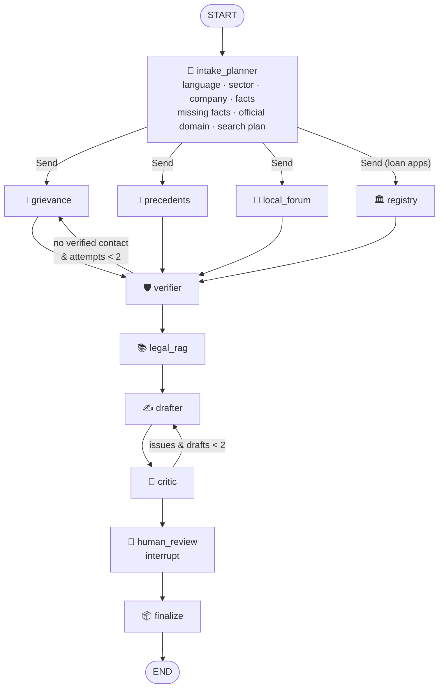

# Shikayat Saathi (शिकायत साथी)

**Every Indian consumer gets a complaints lawyer's first hour, for free, in their own language.**

People lose money not because they lack rights, but because they can't find the path to use them. Shikayat Saathi
takes a complaint written in English, Hindi or Hinglish ("Flipkart ne damaged phone ka refund reject kar diya") and
returns four things:

- a **verified** grievance contact for the company;
- the **exact legal clauses** that back the complaint;
- a ready-to-send complaint letter;
- the **escalation ladder**: company → regulator or ombudsman → consumer commission.

It is a **LangGraph** multi-agent system. Workers run in parallel through `Send`, two loops correct their own
output, a human reviews the draft through `interrupt()` before it is final, and every complaint is checkpointed in
SQLite. Searches use SerpApi's Google Search, Forums, News and Maps.

_Information, not legal advice. Nothing is ever sent automatically._

## Quick start

```bash
cd shikayat_saathi
python3 -m venv .venv && source .venv/bin/activate
pip install -r requirements.txt
cp .env.example .env              # SERPAPI_API_KEY; optional GEMINI_API_KEY (+ GEMINI_MODEL)
docker compose up -d              # local Qdrant (recommended: lets the app and CLI share the index)
python cli.py index               # index the legal corpus (first time only, ~2 min)
streamlit run app.py
```

Run from the CLI:

```bash
python cli.py "Flipkart ne damaged phone ka refund reject kar diya, order 15 Sep ko kiya tha" --city Pune
python cli.py "…" --yes           # approve the human-review step without prompting
python cli.py --resume <thread>   # resume a paused complaint from data/checkpoints.db
python eval/run_eval.py           # metrics → eval/REPORT.md
pytest -q tests/                  # 18 tests, offline
```

## The graph



- **Fan-out / fan-in.** The planner decides which workers run and dispatches them with `Send`. Workers write to
  reducer fields (`contacts`, `precedents`, `trace`, …), and the verifier runs once after all of them finish.
- **Loop 1, the verifier.** If no grievance contact can be verified, the graph goes back to `grievance` and
  searches again with different wording ("nodal officer", "appellate authority", "contact us"). This happens at
  most twice.
- **Loop 2, the critic.** If the draft has an uncited legal reference, a contact that wasn't verified, an invented
  number or ID, or a missing placeholder, it goes back to the drafter with the critic's notes. This also happens
  at most twice. Whatever is still unsupported after that, `finalize` strips out.
- **Human review.** `interrupt()` pauses the graph with the draft, the missing facts and the contacts. The user's
  edits come back through `Command(resume=…)`.
- **Checkpointing.** `SqliteSaver` saves each run to `data/checkpoints.db` under one `thread_id` per complaint,
  so a paused complaint can be resumed later.
- **Streaming.** The UI uses `stream_mode="updates"` to drive a live agent timeline that shows each node and
  every retry.

### Routing: the LLM is the brain, the code is the seatbelt

The LLM handles any complaint; verified routes are cached and reused; code-level guards make sure no unverified
recipient reaches a letter.

| Job | Who does it |
|---|---|
| Understand the complaint: company, issue, kind of problem (`domain_free_text`) | LLM (intake) |
| Pick a verified playbook - only if one genuinely fits (`matched_playbook`, `match_confidence`) | LLM, matching a live menu; code trusts it only above 0.6 |
| Find the authority when nothing fits | LLM + search (route research: official pages only) |
| Very unclear complaint | One clarifying question, then intake runs again |
| Confirm every step and recipient is real | Code: a step needs an official source page we fetched (`*.gov.in`, `*.nic.in` or the company's own domain); a link must be official and appear in that evidence; the recipient must be a verified contact with a source; cited rules must come from retrieved clauses |

A route that passes the checks is saved to `data/playbooks/<key>.json` with its sources and joins intake's menu, so
the playbooks are a verified cache of what the system has learned (e.g. an airline refund learns the AirSewa route
once), not hardcoded knowledge.

## Code layout

```
config.py  app.py  cli.py
saathi/
  state.py         ComplaintState (TypedDict + reducers) and the pydantic models used for structured LLM output
  graph.py         StateGraph: Send fan-out, both loops, interrupt, SqliteSaver; contacts subgraph for the eval
  playbooks.py     sector → regulator escalation ladder, as data
  llm.py           Gemini via google-genai (generate_content, JSON schema output, 1 retry); raises AIUnavailable
  nodes/           intake · grievance · precedents · local_forum · registry_worker · verifier · legal_rag ·
                   drafter · critic · review (human_review + finalize) · common (error/credit wrapper)
  tools/           serp.py (disk cache, credit cap) · fetch.py · domains.py (official-domain resolution)
  rag/             ingest.py (chunk by section, local Qdrant) · store.py (retrieval with act/section metadata)
eval/              companies.csv · complaints.jsonl · decoys.json · run_eval.py → REPORT.md
raw/legal/         the legal corpus (see SOURCES.md)
```

### What each agent does, and its guardrail

| Node | Job | Guardrail |
|---|---|---|
| intake_planner | Detects the language, classifies the sector, extracts the company and facts, lists missing facts, resolves the official domain (Google), plans the searches | The regulator route comes from `playbooks.py`, not from the model |
| grievance | Runs `site:<domain> grievance officer` / `"grievance redressal"` and `<company> grievance officer email` searches, fetches pages and PDFs, and extracts contacts with regex plus the LLM | Any LLM value that doesn't literally appear on the page is dropped and counted |
| precedents | Searches Google Forums and Google News, and keeps only relevant items with how each was resolved | Results must mention the company |
| local_forum | Uses Google Maps to find the District Consumer Disputes Redressal Commission | Skipped, with a note, when no city is given |
| registry | Checks loan apps against RBI's Digital Lending App directory and returns each lender's grievance officer (via LoanLens) | Apps that aren't listed, or that imitate a listed app, are routed to cyber-crime reporting |
| verifier | Marks a contact verified only if it is on the official domain, in a regulator registry, or found on two independent domains | Webmail addresses, look-alike "helpline" domains and phone numbers seen only on third-party sites are never verified |
| legal_rag | Retrieves clauses from six laws in local Qdrant, keeping act, section and source file | Only retrieved clauses can be cited |
| drafter | Writes the letter, the escalation ladder and a summary in the user's language | Missing facts become `[PLACEHOLDERS]` |
| critic | Runs rule checks and an LLM review | Problems loop back to the drafter |
| human_review / finalize | Pauses with `interrupt()`, then builds the final letter, markdown and downloads | Nothing is sent automatically |

## SerpApi usage

| Engine | Used for |
|---|---|
| `google` | The official domain (Knowledge Graph); grievance pages through `site:<official domain>` queries; one open-web query, which is where fake helplines show up |
| `google_forums` | How other consumers' similar complaints were resolved |
| `google_news` | Consumer-court orders and news about similar disputes |
| `google_maps` | The nearest District Consumer Commission, with address, phone and map link |

A complaint uses about 6–8 live calls, or up to 11 when the verifier retries. The cap is `SERPAPI_MAX_CREDITS=12`
per complaint. Every response is cached in `data/cache/serp/`, so re-running a complaint uses 0 credits. Failed
requests don't count against the cap.

## Evaluation

Run `python eval/run_eval.py`. It writes `eval/REPORT.md` and `eval/report.json`.

| Part | What it measures | Result |
|---|---|---|
| **A. Contacts** (`companies.csv`, 20 companies) | Runs the grievance + verifier subgraph on each company and measures: contact found rate, exact-email accuracy against hand-labelled ground truth, verifier precision, unverified contacts caught, average SerpApi calls and latency | _Run with a SerpApi key. Hand-label the empty rows first._ |
| **B. Complaints** (`complaints.jsonl`, 14 complaints including 3 Hindi and 2 Hinglish) | Sector and language accuracy; whether each draft passes the critic; uncited claims in the final letter | sector 100% · language 100% · critic pass 100% · zero uncited 100% (earlier rule-based run, search off - re-run with the AI) |
| **C. Decoys** (`decoys.json`) | Synthetic scam-pattern contacts (look-alike helplines, webmail refund desks, KYC phishing) mixed in with genuine ones | 11/11 decoys rejected · 5/5 genuine contacts kept |

`companies.csv` has official domains prefilled for all 20 companies. Contacts are filled in for only 8 of them:
- 7 were read from the company's own official page on 2026-10-07 and are marked "confirm".
- KreditBee's comes from RBI's loan-app directory.

The other 12 are left for hand labelling, as the brief asks.

## Design choices that differ from the brief

| Brief | This build | Why |
|---|---|---|
| chromadb / FAISS | **Local Qdrant**, with an embedded fallback | Qdrant was required. Run the server with `docker compose`: embedded mode lets only one process open the index, so the app and the CLI can't use it at the same time. |
| `langchain-anthropic` | **Gemini via the google-genai SDK** (`client.interactions.create`, default `gemini-3.8-flash`) | This is the API the team uses. The model is set in `.env` (`GEMINI_MODEL`). |
| `registry/` copied into this repo | The **LoanLens** registry in the sibling folder (`LOANLENS_DIR`) | It keeps one source of RBI data. The worker imports the registry in isolation from this project's code. |
| Legal PDFs downloaded by the user | Already in `raw/legal/` (`SOURCES.md` lists them; 3 come from mirrors) | They were collected earlier. They are unchanged. |

## Limitations

- Many official grievance pages are rendered with JavaScript or block scripts. When that happens, the worker relies
  on Google's excerpts of official-domain pages, and the verifier retry tries other pages. Some companies still
  return "not found".
- "Two independent sources" could be gamed by coordinated spam. That is why phone numbers seen only on third-party
  sites always carry a warning.
- The agents need the AI. Without a Gemini key, or if Gemini fails after its retry, the app and CLI say the AI is
  unavailable and nothing is drafted - there is no rule-based stand-in that would quietly write a worse letter.
  (Code still guards every AI answer: verified contacts, sourced routes, retrieved citations, computed deadlines.)

## AI tools used

- **Claude Code (Claude Opus 5.5)**: built the project.
- **Gemini (`gemini-3.8-flash`) via the google-genai Interactions API**: runs the intake, extraction, precedent
  relevance, drafting and critic steps, with schema-constrained JSON output that is validated with pydantic.
- **BAAI/bge-small-en-v1.5** (fastembed, runs locally): embeds the legal corpus, which is stored in local Qdrant.
